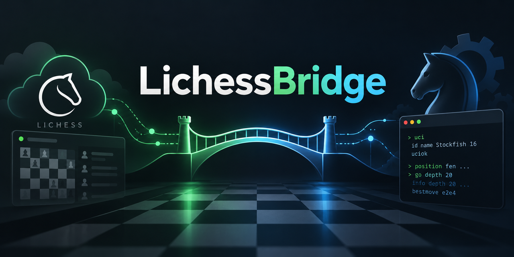

<div align="center">
  
</div>

# LichessBridge

LichessBridge lets a local chess engine play games on [Lichess](https://lichess.org) through a Lichess Bot account. It sits between the Lichess Bot API and the engine process, translating games, moves, clocks, and engine analysis while presenting a live console dashboard.

> [!IMPORTANT]
LichessBridge supports **WinBoard protocol version 2 (WB2)** and **UCI** engines. Select the protocol through `Engine:Protocol`; existing configurations default to WinBoard.

## Features

- Connects a local WB2 or UCI chess engine to a Lichess Bot account
- Accepts or declines challenges using configurable filters
- Supports rated and casual standard games at configurable time controls
- Can automatically challenge eligible online Lichess bots
- Displays the game, clocks, engine analysis, and recent log entries in the console
- Supports pondering and configurable engine startup commands
- Sends optional messages at the beginning and end of each game
- Saves completed games to a PGN file and writes diagnostic logs to disk
- Gracefully reconnects if the Lichess event stream is interrupted

LichessBridge currently plays one game at a time. Support for multiple simultaneous games is planned for a future release.

## Requirements

- Windows, Linux, or macOS with the [.NET 10 SDK](https://dotnet.microsoft.com/download/dotnet/10.0)
- A Lichess account that has been upgraded to a Bot account
- A Lichess personal access token with the `bot:play` scope (and `challenge:write` if automatic outgoing challenges are enabled)
- A chess engine executable that implements WB2 or UCI

Bot accounts are intended for automated play and have different restrictions from regular Lichess accounts. Make sure you understand those restrictions before upgrading an account.

## Configuration

Keep `Bridge/appsettings.json` as the shared defaults. Create an ignored `Bridge/appsettings.Local.json` containing the settings you want to override, for example:

```json
{
  "Engine": {
    "Path": "C:\\ChessEngines\\MyEngine.exe",
    "Name": "My Engine",
    "Ponder": true
  },
  "Games": {
    "PgnPath": "C:\\LichessBridgeData\\games.pgn"
  },
  "Logging": {
    "FilePath": "C:\\LichessBridgeData\\lichessbridge.log"
  }
}
```

On Linux or macOS, use paths appropriate for your system, for example `/opt/engines/my-engine`.

The shared defaults write games, logs, and automatic-challenge history under `data/`. Relative engine and output paths are resolved from the working directory where you start the bridge. Absolute paths can be used for a fixed storage location. Local settings and generated data are ignored by Git.

Configuration files are loaded from the directory containing the application. When using `dotnet run --project Bridge`, the build copies both the shared settings and your local settings to that directory, so the command works from the repository root.

Settings are applied in this order, with later values taking precedence: shared settings, environment-specific settings (`appsettings.{Environment}.json`), local settings, environment variables, the `LICHESS_TOKEN` alias, and command-line arguments. Standard environment variables use double underscores for nesting, for example `Engine__Path` or `Lichess__Token`. JSON arrays are merged by index: a shorter local list does not remove trailing entries from the shared list.

`Logging:FilePath` specifies the base path for daily log files. For example, `lichessbridge.log` writes to `lichessbridge-2026-08-24.log`, and the bridge automatically starts a new file when the date changes.

Console output automatically pauses when our remaining clock reaches `Logging:ConsoleQuietBelowMilliseconds` (default 10000). It resumes above `Logging:ConsoleResumeAboveMilliseconds` (default 15000), or when the game ends. The clock counts down monotonically during our turn even without another server event. Set the quiet threshold to 0 to disable this mode. These values are configured in the shared defaults and can be overridden in `appsettings.Local.json`.

While quiet, the dashboard remains frozen and console log entries are suppressed. Latest status and analysis are retained for resumption; asynchronous file logging continues. Console formatting and rendering run in the background, without making engine callbacks acquire a dashboard lock. A terminal write already in progress may finish as quiet mode begins. Console log queues are bounded and may drop entries under load rather than delay a move.

`GameController` passes coordinate history to the display without preparing SAN. The renderer formats the latest snapshot only when it is allowed to render, so quiet mode also skips this SAN work. The renderer owns its cached position and catches up with any skipped updates after resuming. Disabled Debug diagnostics return before joining command strings or calculating summary fields.

The most important setting is `Engine:Path`, which must point to an engine executable supporting the selected protocol. Parent directories for the PGN, log, and automatic-challenge state files are created when needed.

## Starting the bridge

For security, set the token through the `LICHESS_TOKEN` environment variable instead of committing it to a configuration file. Give the token the `bot:play` scope; the optional automatic bot-challenge feature also requires `challenge:write`.

PowerShell:

```powershell
$env:LICHESS_TOKEN = "your-token"
dotnet run --project Bridge
```

Bash, zsh, or a similar shell:

```bash
export LICHESS_TOKEN="your-token"
dotnet run --project Bridge
```

At startup, LichessBridge launches the engine and verifies the selected protocol handshake before connecting to Lichess. It then waits for a challenge that matches the configured filters.

## Challenge filtering

Incoming challenges are controlled by `Lichess:ChallengeFilter` in the configuration. You can filter by:

- Rated or casual mode
- Human or bot opponents
- Chess variant and Lichess speed category
- Minimum and maximum base time or increment
- Opponent rating or rating difference
- Username allowlists and blocklists
- Whether bullet games must include an increment

For example:

```json
{
  "Lichess": {
    "ChallengeFilter": {
      "Modes": [ "casual", "rated" ],
      "Opponents": [ "human", "bot" ],
      "Variants": [ "standard" ],
      "Speeds": [ "blitz", "rapid" ],
      "MinBaseSeconds": 180,
      "MaxBaseSeconds": 900,
      "MinRating": null,
      "MaxRating": null,
      "AllowList": [],
      "BlockList": []
    }
  }
}
```

The bridge declines challenges that do not satisfy these rules and remains available for the next eligible challenge.

## Automatic bot challenges

The optional `AutoBotChallenge` feature finds eligible online bots and challenges them after the bridge has been idle. It supports multiple time-control profiles, rating filters, allowlists and blocklists, opponent cooldowns, and remembered decline restrictions.

It is disabled by default. To use it, set `AutoBotChallenge:Enabled` to `true` in `Bridge/appsettings.Local.json` and enable at least one profile. Review the paths and profiles before enabling it.

### Automatic challenge settings

| Setting | Description |
| --- | --- |
| `Enabled` | Enables automatic challenges at startup. At least one profile must also be enabled. |
| `IdleDelaySeconds` | Time the bridge remains idle before looking for an opponent. |
| `ChallengeTimeoutSeconds` | Time allowed for an opponent to respond before the outgoing challenge is cancelled. |
| `OnlineBotsCacheSeconds` | How long the list of online bots is cached before it is fetched again. |
| `OpponentCooldownMinutes` | Minimum time before the same opponent may be challenged again. |
| `DeclineHistoryRetentionHours` | How long a declined or rejected challenge affects future opponent selection. |
| `AutoChallengeStatePath` | File used to persist opponent cooldowns and decline restrictions between runs. |
| `AllowList` | If non-empty, only the listed bot usernames or IDs may be challenged. |
| `BlockList` | Bot usernames or IDs that must never be challenged. |
| `MinRating` | Optional minimum opponent rating. Use `null` for no minimum. |
| `MaxRating` | Optional maximum opponent rating. Use `null` for no maximum. |
| `MaxRatingDifference` | Optional maximum difference between your bot's rating and the opponent's rating. |
| `Profiles` | One or more time-control and game-mode profiles, described below. |

> [!WARNING]
> Do not set the automatic-challenge intervals unnecessarily low. In particular, small values for `IdleDelaySeconds`, `OnlineBotsCacheSeconds`, `ChallengeTimeoutSeconds`, or `OpponentCooldownMinutes` can cause the bridge to fetch the online-bot list or create and cancel challenges too frequently. Lichess may then rate-limit the client with HTTP **429 Too Many Requests**. Lichess instructs API clients to make only one request at a time and, after receiving a 429 response, to wait a full minute before making any further API requests. Limits can vary over time, so use conservative intervals. See the official [Lichess API tips](https://lichess.org/page/api-tips#rate-limiting).

### Challenge profiles

LichessBridge rotates between the enabled profiles when looking for opponents. Each profile defines the type of game to request:

| Setting | Description |
| --- | --- |
| `Enabled` | Includes this profile in automatic opponent selection. |
| `Name` | A unique descriptive name used in the dashboard, logs, and challenge history. |
| `Mode` | Either `rated` or `casual`. |
| `Variant` | The Lichess variant to request, such as `standard`. The connected engine must support it. |
| `InitialSeconds` | Initial clock time for each player, in seconds. |
| `IncrementSeconds` | Increment added after each move, in seconds. |
| `MinRating` | Optional profile-specific minimum rating. Overrides the top-level value when set. |
| `MaxRating` | Optional profile-specific maximum rating. Overrides the top-level value when set. |
| `MaxRatingDifference` | Optional profile-specific maximum rating difference. Overrides the top-level value when set. |

When several bots are eligible, the bridge prefers an opponent whose relevant rating is closest to your bot's rating. If your bot has no rating for the profile's time control or variant, the maximum rating difference is skipped and an eligible opponent is selected randomly. Minimum and maximum opponent rating limits still apply, and opponents without a rating are excluded when those limits are configured. Bots on cooldown or covered by a remembered decline restriction are skipped automatically.

### Challenge history and avoiding unnecessary challenges

The file configured by `AutoChallengeStatePath` acts as the automatic challenge history. Its filename is entirely configurable; for example, it may be named `ChallengeHistory.json`. The bridge loads it at startup and updates it whenever it challenges a bot or records a decline or rejection, so the information is preserved across restarts.

The history prevents the bridge from repeatedly sending challenges that are unlikely to be accepted:

- After a bot is challenged, that opponent enters a cooldown for `OpponentCooldownMinutes`.
- If a bot declines because of the time control, only that specific profile is avoided for that bot.
- If a bot declines rated or casual games, that mode is avoided for that bot.
- If a bot declines the requested variant, that variant is avoided for that bot.
- Other declines and API rejections temporarily exclude the opponent altogether.
- Decline restrictions normally remain active for `DeclineHistoryRetentionHours`. If Lichess supplies a specific expiry time for a rejection, the bridge uses that time instead.

This allows the bridge to try another compatible profile when appropriate without repeatedly bothering a bot with a type of challenge it has already declined. Expired cooldowns and restrictions are ignored and removed automatically when the history is next saved.

While the program is running, press:

- `A` to enable or disable automatic challenges
- `C` to send an automatic challenge immediately while automatic challenges are enabled
- `R` twice, then `Y` to confirm and resign the active game; any other key cancels and resets the confirmation
- `Q` to request a graceful shutdown; if a game is active, the bridge finishes it first

## Engine options

The `Engine` section contains the engine integration settings:

| Setting | Description |
| --- | --- |
| `Protocol` | `WinBoard` (default) or `Uci` |
| `Path` | Path to the engine executable |
| `Name` | Name shown in the console dashboard |
| `Ponder` | Allows the engine to think during the opponent's turn |
| `MoveOverheadMilliseconds` | Time reserved for communication and network latency |
| `SearchStatusPollMilliseconds` | WinBoard search-status polling interval; ignored for UCI, which sends `info` updates itself |
| `StartupCommands` | Additional WinBoard commands sent during startup; must be empty for UCI |
| `Uci:Options` | Engine-specific UCI option names and string values, validated against the engine's advertised options |
| `Uci:ResponseTimeoutSeconds` | Timeout for UCI startup, readiness, and stopping an old search; default 10 seconds |

For a UCI engine, put the following override in `Bridge/appsettings.Local.json`, adjusting paths and options to the installed engine:

```json
{
  "Engine": {
    "Protocol": "Uci",
    "Path": "C:\\ChessEngines\\stockfish.exe",
    "Name": "Stockfish",
    "Ponder": true,
    "MoveOverheadMilliseconds": 0,
    "Uci": {
      "Options": {
        "Threads": "4",
        "Hash": "256",
        "MultiPV": "1",
        "SyzygyPath": "D:\\Tablebases\\Syzygy"
      }
    }
  }
}
```

Option availability and numeric limits depend on the engine. Unsupported option names or invalid values fail startup with a configuration error. Set pondering only through `Engine:Ponder`; do not duplicate it in `Uci:Options`. Button options use an empty string, for example `"Clear Hash": ""`. Other engine settings, such as Stockfish's own `Move Overhead`, are independent of the bridge's reserve, so account for both if configuring them together.

UCI search status shows, for example, `move 18 / 32`: the current move number comes from the engine and the total is the legal root-move count calculated by Bridge in the background. The calculation uses a cached board and does not block engine communication or move submission. It is skipped in quiet mode, and obsolete queued calculations are discarded. An already running calculation may finish. Until the total is available, only `move 18` is shown. Predicted ponder positions use their own root count. An engine may internally restrict its candidates, so the displayed denominator describes legal moves, not a guaranteed number of moves searched at every depth.

The counter generates moves per piece with candidate SAN generation disabled, avoiding the third-party library's parallel whole-board generation. Cache updates locate only moves from the known source square. The library's `Move` API still prepares notation for the actual applied move internally; Bridge no longer requests SAN for every candidate just to update the position or count legal moves. UCI positions are sent immediately before starting a search, so preparing a position and then starting pondering does not send redundant histories.

## Game and chat options

`Games:PgnPath` selects the PGN file to which completed games are appended. `Games:AbortIfNoMoveSeconds` controls how long the bridge waits before aborting a game in which no move has been made.

`Chat:StartMessage` and `Chat:EndMessage` provide optional Lichess chat messages. Use an empty string to disable either message. Lichess limits these messages to 140 characters.

## Security

Never store your Lichess access token in `appsettings.json` or commit it to source control. The `LICHESS_TOKEN` environment variable is the preferred way to supply credentials.

Keep machine-specific paths, bot messages, and preferences in `appsettings.Local.json`. Debug logging includes Lichess event payloads and engine protocol messages; review logs before sharing them in an issue.

The secret-scanning workflow runs Gitleaks on pushes, pull requests, and a weekly schedule. It uses the standard detection rules plus a Lichess token rule. To check the repository locally with Gitleaks installed, run `gitleaks git --redact --config .gitleaks.toml --log-opts="--all"`. The CI scan does not prevent a secret from being pushed; GitHub push protection provides that additional check for supported secret types.

Dependabot checks NuGet dependencies and GitHub Actions weekly and opens pull requests for updates. Minor and patch NuGet updates are grouped together.

## Building, testing, and publishing

```sh
dotnet build LichessBridge.slnx --configuration Release
dotnet test LichessBridge.slnx --configuration Release
dotnet publish Bridge --configuration Release --output publish
```

Publishing includes the shared settings. Your `appsettings.Local.json` is deliberately excluded. Create `appsettings.Local.json` next to the published `LichessBridge.dll` using the configuration example above, configure the engine, set `LICHESS_TOKEN`, and start it with `dotnet LichessBridge.dll` from the publish directory. Output paths remain relative to the working directory.

The chess engine is supplied separately and is not included in the repository or published application.

## License

LichessBridge is licensed under the [MIT License](LICENSE).
