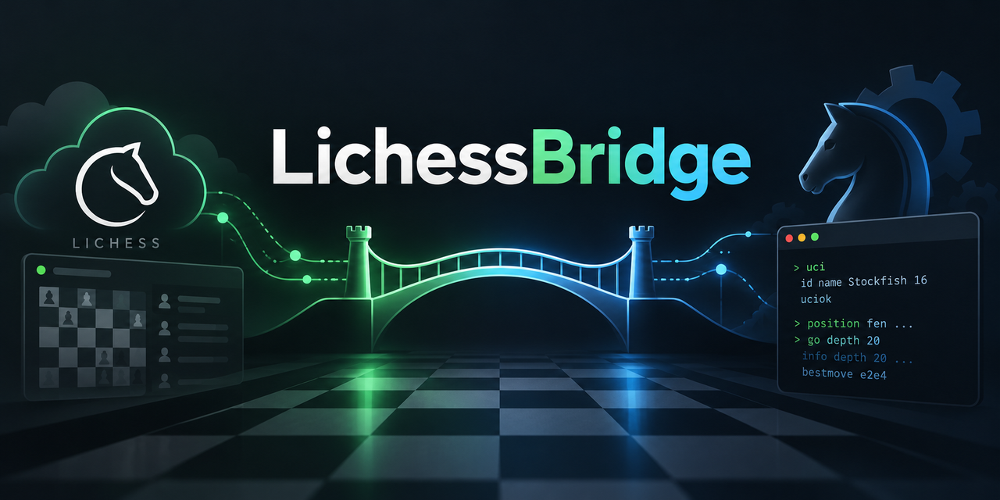

<div align="center">
  
</div>

# LichessBridge

LichessBridge lets a local chess engine play games on [Lichess](https://lichess.org) through a Lichess Bot account. It sits between the Lichess Bot API and the engine process, translating games, moves, clocks, and engine analysis while presenting a live console dashboard.

> [!IMPORTANT]
> LichessBridge currently supports **WinBoard protocol version 2 (WB2) engines only**. UCI engine support is planned for a future release.

## Features

- Connects a local WB2 chess engine to a Lichess Bot account
- Accepts or declines challenges using configurable filters
- Supports rated and casual standard games at configurable time controls
- Can automatically challenge eligible online Lichess bots
- Displays the game, clocks, engine analysis, and recent log entries in the console
- Supports pondering and configurable engine startup commands
- Sends optional messages at the beginning and end of each game
- Saves completed games to a PGN file and writes diagnostic logs to disk
- Gracefully reconnects if the Lichess event stream is interrupted

LichessBridge currently plays one game at a time. Support for multiple simultaneous games is planned for a future release.

## Requirements

- Windows, Linux, or macOS with the [.NET 10 SDK](https://dotnet.microsoft.com/download/dotnet/10.0)
- A Lichess account that has been upgraded to a Bot account
- A Lichess personal access token with the `bot:play` scope (and `challenge:write` if automatic outgoing challenges are enabled)
- A chess engine executable that implements the WB2 protocol

Bot accounts are intended for automated play and have different restrictions from regular Lichess accounts. Make sure you understand those restrictions before upgrading an account.

## Configuration

Open `Bridge/appsettings.json` and configure the engine and output paths for your system:

```json
{
  "Engine": {
    "Path": "C:\\ChessEngines\\MyEngine.exe",
    "Name": "My Engine",
    "Ponder": true
  },
  "Games": {
    "PgnPath": "C:\\LichessBridgeData\\games.pgn"
  },
  "Logging": {
    "FilePath": "C:\\LichessBridgeData\\lichessbridge.log"
  }
}
```

On Linux or macOS, use paths appropriate for your system, for example `/opt/engines/my-engine`.

`Logging:FilePath` specifies the base path for daily log files. For example, `lichessbridge.log` writes to `lichessbridge-2026-08-24.log`, and the bridge automatically starts a new file when the date changes.

The most important setting is `Engine:Path`, which must point to a working WB2 engine executable. Parent directories for the PGN, log, and automatic-challenge state files are created when needed.

## Starting the bridge

For security, set the token through the `LICHESS_TOKEN` environment variable instead of committing it to a configuration file. Give the token the `bot:play` scope; the optional automatic bot-challenge feature also requires `challenge:write`.

PowerShell:

```powershell
$env:LICHESS_TOKEN = "your-token"
dotnet run --project Bridge
```

Bash, zsh, or a similar shell:

```bash
export LICHESS_TOKEN="your-token"
dotnet run --project Bridge
```

At startup, LichessBridge launches the engine and verifies its WB2 handshake before connecting to Lichess. It then waits for a challenge that matches the configured filters.

## Challenge filtering

Incoming challenges are controlled by `Lichess:ChallengeFilter` in the configuration. You can filter by:

- Rated or casual mode
- Human or bot opponents
- Chess variant and Lichess speed category
- Minimum and maximum base time or increment
- Opponent rating or rating difference
- Username allowlists and blocklists
- Whether bullet games must include an increment

For example:

```json
{
  "Lichess": {
    "ChallengeFilter": {
      "Modes": [ "casual", "rated" ],
      "Opponents": [ "human", "bot" ],
      "Variants": [ "standard" ],
      "Speeds": [ "blitz", "rapid" ],
      "MinBaseSeconds": 180,
      "MaxBaseSeconds": 900,
      "MinRating": null,
      "MaxRating": null,
      "AllowList": [],
      "BlockList": []
    }
  }
}
```

The bridge declines challenges that do not satisfy these rules and remains available for the next eligible challenge.

## Automatic bot challenges

The optional `AutoBotChallenge` feature finds eligible online bots and challenges them after the bridge has been idle. It supports multiple time-control profiles, rating filters, allowlists and blocklists, opponent cooldowns, and remembered decline restrictions.

It is disabled by default. To use it, set `AutoBotChallenge:Enabled` to `true` and enable at least one profile. Review the paths and profiles in `Bridge/appsettings.json` before enabling it.

### Automatic challenge settings

| Setting | Description |
| --- | --- |
| `Enabled` | Enables automatic challenges at startup. At least one profile must also be enabled. |
| `IdleDelaySeconds` | Time the bridge remains idle before looking for an opponent. |
| `ChallengeTimeoutSeconds` | Time allowed for an opponent to respond before the outgoing challenge is cancelled. |
| `OnlineBotsCacheSeconds` | How long the list of online bots is cached before it is fetched again. |
| `OpponentCooldownMinutes` | Minimum time before the same opponent may be challenged again. |
| `DeclineHistoryRetentionHours` | How long a declined or rejected challenge affects future opponent selection. |
| `AutoChallengeStatePath` | File used to persist opponent cooldowns and decline restrictions between runs. |
| `AllowList` | If non-empty, only the listed bot usernames or IDs may be challenged. |
| `BlockList` | Bot usernames or IDs that must never be challenged. |
| `MinRating` | Optional minimum opponent rating. Use `null` for no minimum. |
| `MaxRating` | Optional maximum opponent rating. Use `null` for no maximum. |
| `MaxRatingDifference` | Optional maximum difference between your bot's rating and the opponent's rating. |
| `Profiles` | One or more time-control and game-mode profiles, described below. |

> [!WARNING]
> Do not set the automatic-challenge intervals unnecessarily low. In particular, small values for `IdleDelaySeconds`, `OnlineBotsCacheSeconds`, `ChallengeTimeoutSeconds`, or `OpponentCooldownMinutes` can cause the bridge to fetch the online-bot list or create and cancel challenges too frequently. Lichess may then rate-limit the client with HTTP **429 Too Many Requests**. Lichess instructs API clients to make only one request at a time and, after receiving a 429 response, to wait a full minute before making any further API requests. Limits can vary over time, so use conservative intervals. See the official [Lichess API tips](https://lichess.org/page/api-tips#rate-limiting).

### Challenge profiles

LichessBridge rotates between the enabled profiles when looking for opponents. Each profile defines the type of game to request:

| Setting | Description |
| --- | --- |
| `Enabled` | Includes this profile in automatic opponent selection. |
| `Name` | A unique descriptive name used in the dashboard, logs, and challenge history. |
| `Mode` | Either `rated` or `casual`. |
| `Variant` | The Lichess variant to request, such as `standard`. The connected engine must support it. |
| `InitialSeconds` | Initial clock time for each player, in seconds. |
| `IncrementSeconds` | Increment added after each move, in seconds. |
| `MinRating` | Optional profile-specific minimum rating. Overrides the top-level value when set. |
| `MaxRating` | Optional profile-specific maximum rating. Overrides the top-level value when set. |
| `MaxRatingDifference` | Optional profile-specific maximum rating difference. Overrides the top-level value when set. |

When several bots are eligible, the bridge prefers an opponent whose relevant rating is closest to your bot's rating. If your bot has no rating for the profile's time control or variant, the maximum rating difference is skipped and an eligible opponent is selected randomly. Minimum and maximum opponent rating limits still apply, and opponents without a rating are excluded when those limits are configured. Bots on cooldown or covered by a remembered decline restriction are skipped automatically.

### Challenge history and avoiding unnecessary challenges

The file configured by `AutoChallengeStatePath` acts as the automatic challenge history. Its filename is entirely configurable; for example, it may be named `ChallengeHistory.json`. The bridge loads it at startup and updates it whenever it challenges a bot or records a decline or rejection, so the information is preserved across restarts.

The history prevents the bridge from repeatedly sending challenges that are unlikely to be accepted:

- After a bot is challenged, that opponent enters a cooldown for `OpponentCooldownMinutes`.
- If a bot declines because of the time control, only that specific profile is avoided for that bot.
- If a bot declines rated or casual games, that mode is avoided for that bot.
- If a bot declines the requested variant, that variant is avoided for that bot.
- Other declines and API rejections temporarily exclude the opponent altogether.
- Decline restrictions normally remain active for `DeclineHistoryRetentionHours`. If Lichess supplies a specific expiry time for a rejection, the bridge uses that time instead.

This allows the bridge to try another compatible profile when appropriate without repeatedly bothering a bot with a type of challenge it has already declined. Expired cooldowns and restrictions are ignored and removed automatically when the history is next saved.

While the program is running, press:

- `A` to enable or disable automatic challenges
- `C` to send an automatic challenge immediately while automatic challenges are enabled
- `R` twice to confirm and resign the active game
- `Q` to request a graceful shutdown; if a game is active, the bridge finishes it first

## Engine options

The `Engine` section contains the engine integration settings:

| Setting | Description |
| --- | --- |
| `Path` | Path to the WB2 engine executable |
| `Name` | Name shown in the console dashboard |
| `Ponder` | Allows the engine to think during the opponent's turn |
| `MoveOverheadMilliseconds` | Time reserved for communication and network latency |
| `SearchStatusPollMilliseconds` | Interval used to refresh engine search information |
| `StartupCommands` | Additional commands sent to the engine during startup |

## Game and chat options

`Games:PgnPath` selects the PGN file to which completed games are appended. `Games:AbortIfNoMoveSeconds` controls how long the bridge waits before aborting a game in which no move has been made.

`Chat:StartMessage` and `Chat:EndMessage` provide optional Lichess chat messages. Use an empty string to disable either message. Lichess limits these messages to 140 characters.

## Protocol roadmap

The current engine adapter is specifically built for **WinBoard protocol version 2 (WB2)**. A UCI engine cannot be used directly with this version of LichessBridge. Native **UCI support is planned**, with the goal of making the bridge useful with a much wider range of modern chess engines.

## Security

Never store your Lichess access token in `appsettings.json` or commit it to source control. The `LICHESS_TOKEN` environment variable is the preferred way to supply credentials.
